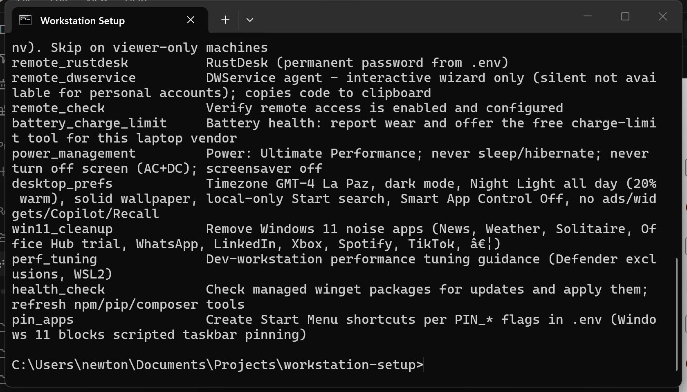

# Workstation Setup

> **On Windows 11?** Use [`dev-setup.cmd`](dev-setup.cmd) (or [`dev-setup-admin.cmd`](dev-setup-admin.cmd) for an elevated run). Do not invoke `dev-setup.ps1` directly on a new machine, see [README-windows.md](README-windows.md).

Interactive, idempotent development-environment bootstrapper for Ubuntu, with a Windows 11 port.

**License:** MIT, keep the copyright line in `LICENSE` so attribution survives forks.  
**Author:** Daniel Llano ([github.com/daniel-llano](https://github.com/daniel-llano))  
**Tests:** [TESTING.md](TESTING.md) (`.\scripts\test.ps1` / `./scripts/test.sh`)

`dev-setup.cmd -List` prints every Windows step and does not install anything. The dry-run for `battery_charge_limit` is the same idea. A missing `.env` must not abort that run.



Installs languages/toolchains, editors, Docker, CLI tools, communication
apps, remote access, and applies power/performance tuning, one step at a
time, asking before each one (unless told otherwise), and continuing past a
failed step instead of aborting the whole run.

- [Quick start](#quick-start)
- [Command-line usage](#command-line-usage)
- [Steps](#steps)
- [Settings file (`.env`)](#settings-file-env)
- [RustDesk on Ubuntu 26+ (Wayland-only GNOME)](#rustdesk-on-ubuntu-26-wayland-only-gnome)
- [Battery charge limiting](#battery-charge-limiting)
- [Dock pinning](#dock-pinning)
- [Health check](#health-check)
- [PATH check](#path-check)
- [Trying the new .env-driven features step by step](#trying-the-new-env-driven-features-step-by-step)
- [Logs and re-running](#logs-and-re-running)
- [Notes and caveats](#notes-and-caveats)

## Quick start

```bash
# 1. See what's available
./dev-setup.sh --list

# 2. (optional) Configure settings so steps like git/gh and remote access
#    don't need to ask questions on the console - see below.
cp .env-sample .env
chmod 600 .env
$EDITOR .env

# 3. Dry-run first, nothing is changed, every command that *would* run is printed
./dev-setup.sh -n

# 4. Run for real, confirming each step
./dev-setup.sh

# ...or run everything non-interactively
./dev-setup.sh -y
```

The script refuses to run as root, run it as your normal user; it asks for
`sudo` once up front and keeps that session alive for the duration of the
run.

## Command-line usage

```
./dev-setup.sh                 interactive: ask before each step
./dev-setup.sh -y               non-interactive: install everything
./dev-setup.sh -n               dry-run: print what would happen, change nothing
./dev-setup.sh --only=a,b       only run the given step ids
./dev-setup.sh --skip=a,b       run everything except the given step ids
./dev-setup.sh --list           list step ids and exit
./dev-setup.sh --profile=minimal  core toolchain only
./dev-setup.sh --profile=server   console/server: skip GUI apps
./dev-setup.sh --profile=desktop  force GUI apps on a server image
./dev-setup.sh -h               help
```

| Flag | Description |
|---|---|
| `-y`, `--yes` | Assume yes for every step; also skips the interactive git identity prompt (use `.env` instead if you want git configured non-interactively in this mode). |
| `-n`, `--dry-run` | Print every command each step *would* run, without executing anything. Safe to use to preview a run, including against a real `.env`. |
| `--only=a,b,c` | Run only the listed step ids, no confirmation prompts. |
| `--skip=a,b,c` | Run every step except the listed ids. Confirmation prompts still apply unless combined with `-y`. |
| `--profile=minimal` | Shorthand for prereqs, path_check, git_gh, dotnet, python, node_nvm, vscode, docker, cli_tools |
| `--profile=server` | Console/server: skip GUI apps (Chrome, Slack, VS Code GUI, GNOME RDP/VNC, dock pins, desktop prefs). Auto-detected on images without `ubuntu-desktop` / GNOME; `-y` also skips those steps unless you pass `--profile=desktop`. |
| `--profile=desktop` | Force GUI apps even on a server image. |
| `-h`, `--help` | Print a short usage summary and the step list, then exit. |

`--only` and `--skip` take comma-separated step ids (no spaces), e.g.
`./dev-setup.sh --only=docker,kubectl --yes`.

`NO_COLOR=1 ./dev-setup.sh` disables colored output.

## Steps

Run `./dev-setup.sh --list` for the authoritative, current list, this table
mirrors it for reference:

| id | Installs |
|---|---|
| `prereqs` | Base prerequisites (curl, wget, gnupg, ca-certificates...) |
| `path_check` | Verifies `PATH` has this script's tool directories, fixing/re-adding what's missing |
| `git_gh` | Git + GitHub CLI (`gh`); reads identity/token from `.env`, re-applies globally only when it detects a change |
| `cpp_build` | C++ light toolchain (build-essential/gcc, cmake, ninja, gdb, clang, Code::Blocks). No Linux twin of Windows' optional multi-GB `cpp_msvc` / Windows SDK step. |
| `java_scala` | Java + Scala + sbt via SDKMAN! |
| `dotnet` | .NET SDK (current LTS) |
| `python` | Python 3 + pipx + poetry/ruff/black/mypy/httpie/ipython |
| `node_nvm` | Node.js via nvm (current LTS) + npm/pnpm/yarn/typescript/eslint/prettier |
| `php` | PHP + Composer + Laravel installer (Laravel/CodeIgniter development) |
| `vscode` | Visual Studio Code |
| `vscode_ext` | VS Code extensions for the stacks actually present on this machine, an explicit `--skip=docker,java_scala` drops theirs, but answering `n` to a step you already have installed does not |
| `cursor` | Cursor (AI code editor) |
| `chatgpt` | ChatGPT desktop app (official OpenAI Linux client, public preview) |
| `editor_pdf` | Text editor + PDF reader + MarkText (Markdown) |
| `libreoffice` | LibreOffice |
| `postman_newman` | Postman + Newman CLI |
| `playwright` | Playwright (CLI + browsers) |
| `docker` | Docker Engine + Compose |
| `kubectl` | kubectl |
| `archive_tools` | Archive tools (zip, unzip, 7z, unrar, zstd) |
| `cli_tools` | CLI productivity/research tools (ripgrep, fd, bat, fzf, jq, yq, htop, glances, tmux, delta...) |
| `chrome` | Google Chrome |
| `remmina` | Remmina RDP/VNC/SSH **client** (viewer machines; Windows: `vnc_viewer`). Server share is `remote_vnc`. |
| `obs` | OBS Studio |
| `media_apps` | VLC + codecs (GUI; Zoom is `comms_zoom`) |
| `ai_media` | ffmpeg, ImageMagick, poppler-utils, qpdf, tesseract, ocrmypdf |
| `comms_zoom` | Zoom (optional; own yes/no) |
| `comms_slack` | Slack |
| `comms_teams` | Microsoft Teams (community client) |
| `comms_notion` | Notion (community client) |
| `comms_pumble` | Pumble |
| `comms_linear` | Linear (web-app launcher) |
| `comms_clockify` | Clockify (time tracking) |
| `remote_ssh` | SSH remote login. **Never creates an OS user unless you confirm** after it prints whether `REMOTE_USER` already exists (`-y` never creates/resets accounts). |
| `remote_gnome_desktop` | GNOME Remote Desktop (native Wayland RDP, session + GDM login) |
| `remote_vnc` | VNC server on port 5900 (GNOME Remote Desktop VNC, or TigerVNC; password from `.env`) |
| `remote_rustdesk` | RustDesk, stable release, or the unattended-Wayland preview build on Ubuntu 26+ (permanent password from `.env`) |
| `remote_dwservice` | DWService agent, **interactive console wizard** (`dwagent.sh -console`; silent not available for personal accounts) |
| `remote_check` | Verify remote access is enabled and configured |
| `battery_charge_limit` | Battery health: report wear, then cap charging at `BATTERY_CHARGE_LIMIT`% (or point at the free tool that can), see below |
| `power_management` | Never sleep on AC; write logind drop-in **without** restarting logind on an active desktop (avoids killing GNOME/Wayland) |
| `desktop_prefs` | Timezone from `TIMEZONE`, GNOME dark mode, Night Light all day (20% warm), solid wallpaper, Chrome as default browser |
| `desktop_cleanup` | Remove Ubuntu games, Weather, Maps, Tour, Rhythmbox, Totem, Thunderbird |
| `perf_tuning` | Dev-workstation performance tuning (inotify limits, swappiness, zram) |
| `health_check` | Checks managed apt/snap packages for broken or outdated state and fixes/updates them; refreshes npm/pipx tools, see [Health check](#health-check) below |
| `pin_apps` | Pin installed tools to the dock, following the `PIN_*` flags in `.env`, see [Dock pinning](#dock-pinning) below |

Steps that download an installer (`chrome`, `cursor`, `chatgpt`,
`remote_rustdesk`) will use a matching `.deb` sitting next to the script
instead of downloading one, if present (e.g.
`google-chrome-stable_current_amd64.deb`, `cursor_*_amd64.deb`,
`chatgpt_amd64.deb`, `rustdesk-*.deb`).

## Settings file (`.env`)

Some steps can be driven non-interactively from a `.env` file next to the
script, instead of asking questions on the console or being skipped. Copy
the template and fill in what you need:

```bash
cp .env-sample .env
chmod 600 .env
$EDITOR .env
```

`.env` is:
- **Never required.** Every step that reads it degrades gracefully when a
  key is missing, `git_gh` falls back to its old interactive prompt, the
  remote-access steps just skip themselves with a warning telling you what
  to add.
- **Never sourced as shell.** It's parsed as strict `KEY=VALUE` lines and
  only a fixed set of known keys are read, arbitrary code in `.env` cannot
  execute.
- **Auto-locked down.** If the script finds `.env` readable/writable by
  group or others, it tightens it to `600` automatically before reading it.
- **Local only.** It is never uploaded, curled, or transmitted anywhere.

### Keys

| Key | Used by | Notes |
|---|---|---|
| `EMAIL` | (shared default) | Reused as the default for `GIT_USER_EMAIL` and `DWSERVICE_USER` below when they're left empty, so you only type your email once. Per-app keys still override it individually. |
| `GIT_USER_NAME` | `git_gh` | Sets `git config --global user.name`. Compared against the current global value each run and only re-applied (with a logged before/after) when it's actually changed. |
| `GIT_USER_EMAIL` | `git_gh` | Sets `git config --global user.email`. Defaults to `EMAIL`. Same change-detection as `GIT_USER_NAME`. |
| `GH_TOKEN` | `git_gh` | GitHub personal access token; runs `gh auth login --with-token` non-interactively instead of opening a browser prompt. Create one at https://github.com/settings/tokens. A sha256 of the token (never the token itself) is kept in `~/.local/state/dev-setup/gh-token-sha256` so that rotating this value re-authenticates `gh` even if it already reports itself logged in - otherwise a token rotation would silently go unapplied. |
| `REMOTE_USER` | `remote_ssh`, `remote_gnome_desktop` | Candidate Linux login. The script **prints whether it exists, then asks `[y/N]`** before creating or resetting it. `-y` never creates/resets OS accounts (uses your current login instead). GNOME RDP/VNC protocol credentials reuse this name without creating a user. |
| `REMOTE_PASSWORD` | `remote_ssh`, `remote_gnome_desktop`, `remote_vnc`, `remote_rustdesk` | Password for `REMOTE_USER` (only if you confirmed creating/resetting that OS account); also GNOME RDP/VNC and RustDesk's default permanent password. |
| `RUSTDESK_PASSWORD` | `remote_rustdesk` | Overrides `REMOTE_PASSWORD` for RustDesk specifically, if you want it different. The only RustDesk credential that's actually scriptable, RustDesk's public server has no email/password account login (its GUI only offers Google/GitHub OAuth buttons). |
| `RUSTDESK_USER` | *(not read by the script)* | Reference-only field for your own bookkeeping, which RustDesk-account email this device's permanent password belongs to. Not a functional login; dev-setup.sh never reads it. |
| `RUSTDESK_WAYLAND_PREVIEW` | `remote_rustdesk` | `auto` (default)/`true`/`false`, see [RustDesk on Ubuntu 26+](#rustdesk-on-ubuntu-26-wayland-only-gnome) below. |
| `DWSERVICE_KEY` | `remote_dwservice` | Device key / install code. Copied to the clipboard for the interactive wizard. |
| `DWSERVICE_USER` | `remote_dwservice` | DWService account identifier. Defaults to `EMAIL`. |
| `DWSERVICE_PASSWORD` | `remote_dwservice` | Copied to clipboard only if `DWSERVICE_KEY` is empty (wizard paste). |
| `BATTERY_CHARGE_LIMIT` | `battery_charge_limit` | Percentage to cap charging at (default `80` if left empty), see [Battery charge limiting](#battery-charge-limiting) below. |
| `TIMEZONE` | `desktop_prefs` | IANA timezone, e.g. `Europe/Madrid`. Empty leaves the clock alone. |
| `NIGHT_LIGHT_STRENGTH` | `desktop_prefs` | Night Light warmth % (default `20`; full-day schedule). |
| `PACKAGEKIT_MODE` | apt helpers | Ubuntu: `auto` / `stop` / `mask` / `leave`, how to handle PackageKit apt locks (never delete lock files; leave unattended-upgrades on). |
| `PIN_VSCODE`, `PIN_CURSOR`, `PIN_CHATGPT`, `PIN_CHROME`, `PIN_LIBREOFFICE`, `PIN_POSTMAN`, `PIN_REMMINA`, `PIN_SLACK`, `PIN_TEAMS`, `PIN_NOTION`, `PIN_PUMBLE`, `PIN_LINEAR`, `PIN_CLOCKIFY`, `PIN_EDITOR_PDF` | `pin_apps` | `true`/`false`, whether that app's icon stays pinned to the GNOME dock. Defaults to `true` when unset. See [Dock pinning](#dock-pinning) below. |

> **DWService silent install is not available for personal/normal accounts**
> (business/org only). This script only offers the interactive wizard:
> ```bash
> ./dev-setup.sh --only=remote_dwservice
> ```
> It copies `DWSERVICE_KEY` (or `DWSERVICE_PASSWORD` if no key) to the
> clipboard, then runs the installer step-by-step. Legacy
> `--only=remote_dwservice_manual` still maps here. Skipped under a blanket
> `-y` full run (needs a real wizard session).

**Why usernames stay separate:** `EMAIL` unifies the one value every
email-shaped setting genuinely shares. Usernames don't, your Linux login
(`REMOTE_USER`), your git display name (`GIT_USER_NAME`), and your
DWService account (`DWSERVICE_USER`, which defaults to `EMAIL` since
DWService accounts are normally email-based anyway) are legitimately
different strings per app, so each keeps its own key.

**Deliberately not in `.env`:** Slack, Microsoft Teams, Notion, Pumble,
Linear, and Clockify are installed by the script but authenticate through
their own OAuth/web login screens on first launch, there's no unattended
credential the script could hand them, so log into each by hand after
install.

## RustDesk on Ubuntu 26+ (Wayland-only GNOME)

Ubuntu 26.04 LTS ("Resolute Raccoon") shipped GNOME 50, which **removed the
GNOME-on-X11 session entirely**, GNOME is Wayland-only there, with no X11
session left to fall back on. RustDesk's regular stable release does
best-effort unattended screen capture on Wayland via GNOME's remote-desktop
portal, which historically has needed an X11 escape hatch for fully
unattended access (e.g. from the login screen after a reboot, before anyone
has a session open), an escape hatch Ubuntu 26+ no longer has.

RustDesk has a newer **preview build** that solves this properly, true
unattended Wayland access, including from the GDM login screen after
reboot, described at
[rustdesk.com/blog/unattended-remote-access-wayland](https://rustdesk.com/blog/unattended-remote-access-wayland/).
It ships as `rustdesk-unattended-wayland-<version>-<arch>.deb`, published on
RustDesk's rolling `nightly` GitHub release rather than as a numbered
version, the `remote_rustdesk` step resolves the current asset from that
release each time it runs, rather than hardcoding a filename that will go
stale.

`remote_rustdesk` picks which build to install based on `RUSTDESK_WAYLAND_PREVIEW`:

- **`auto`** (default, or leave the key empty/unset), the regular stable
  release, *except* on Ubuntu 26+, where it uses the preview build instead.
- **`true`**, always use the preview build, regardless of Ubuntu version.
- **`false`**, always use the regular stable release, regardless of Ubuntu
  version.

The preview build is still explicitly under real-world testing upstream (not
yet folded into RustDesk's normal releases), which is why it isn't
unconditionally forced on for every Ubuntu 26+ user without a way to opt out.

**Switching between stable and the preview build:** because both ship the
same `rustdesk` package name, `remote_rustdesk` tracks which exact preview
asset is currently installed in
`~/.local/state/dev-setup/rustdesk-wayland-asset` and removes+reinstalls
whenever what's installed doesn't match what should be (an old preview
build, a stale one, or the stable package), a plain `apt install` of the
new `.deb` over an old one can otherwise silently no-op if their version
strings happen to match. Switching from the preview build back to stable
(`RUSTDESK_WAYLAND_PREVIEW=false` after previously running with the preview
build installed) currently needs a manual `sudo apt-get remove rustdesk`
first, `remote_rustdesk` doesn't auto-downgrade off the preview build.

## Battery charge limiting

`battery_charge_limit` caps charging around `BATTERY_CHARGE_LIMIT`% (default
`80`) instead of always topping the battery up to 100%, keeping a lithium
battery below roughly 80-90% instead of constantly at full charge is one of
the best-documented ways to slow its long-term wear.

Both scripts also report cell wear first (current full-charge capacity as a
percentage of the design capacity), since a battery that has already lost
20%+ is the reason to start capping.

### Ubuntu

This only works where the kernel's battery driver actually exposes a
charge-threshold control in sysfs, the step checks both attribute names
different drivers use (`charge_control_end_threshold`, the newer
standardized name used by ThinkPads and an increasing number of ASUS/Dell/
Lenovo IdeaPad/Huawei/System76 models on a recent kernel, and
`charge_stop_threshold`, an older name some drivers still use) under
`/sys/class/power_supply/BAT*/`.

Where it *is* supported, the step:
1. Writes the threshold immediately via `sudo tee` on the sysfs path found,
   plus the matching *start* threshold (5 points lower) where the driver has
   one, ThinkPads will oscillate around the cap without it.
2. Installs `/usr/local/bin/dev-setup-battery-charge-limit.sh` plus a
   `dev-setup-battery-charge-limit.service` systemd unit that reapplies it
   on every boot, not every driver's embedded controller remembers the
   setting across a power cycle the way ThinkPads typically do, so this
   keeps it in effect even on ones that forget.

On a desktop (no battery) it's a no-op. On a laptop whose driver exposes
neither attribute it prints the free options that remain, the UEFI setting,
the vendor kernel module to try loading, and why **TLP is not installed**:
TLP's `START/STOP_CHARGE_THRESH_BAT0` drive the same sysfs attributes this
step uses, so it adds persistence rather than hardware support, and it
conflicts with `power-profiles-daemon`, which the `power_management` step
relies on for AC/battery profile switching.

Check the current value any time with:
```bash
cat /sys/class/power_supply/BAT0/charge_control_end_threshold 2>/dev/null || \
cat /sys/class/power_supply/BAT0/charge_stop_threshold
```

### Windows

Windows has **no** OS-level charge-threshold API, no equivalent of the sysfs
attribute above. The cap lives in the laptop's embedded controller, so it can
only come from UEFI firmware or the vendor's own tool. The step matches your
manufacturer and points at the free option, offering to install it where one
is installable:

| Vendor | Free option | Installed by this step |
| --- | --- | --- |
| ASUS | G-Helper (open source, single exe) | yes, `seerge.g-helper` |
| Lenovo | Lenovo Vantage; Legion Toolkit (open source) as an alternative | yes, `9WZDNCRFJ4MV` |
| Dell / Alienware | Dell Optimizer | yes, `Dell.Optimizer` |
| MSI | MSI Center → Battery Master | yes, `MSI.MSICenter` |
| HP, Framework, Clevo/Tongfang (MECHREVO, Hasee, XMG, Eluktronics…) | UEFI setting (`Battery Health Manager`, `Charge Limit`, `FlexiCharger`) | no, firmware only |
| Acer, Surface, Samsung, LG, Razer, Huawei/Honor, Gigabyte, Dynabook | preinstalled vendor app | no, already present |

It deliberately does **not** install the third-party tools that poke EC
registers through a generic ring-0 driver: those need per-model register
discovery, fail silently on the wrong register, and WinRing0 itself is on
Microsoft's vulnerable-driver blocklist. Prefer the UEFI setting where your
model has one, it survives OS reinstalls and applies while the machine is
asleep or off.

## Dock pinning

`pin_apps` pins the GUI apps this script installs to the GNOME dock, one
`PIN_*` flag per app in `.env` (see the [Keys](#keys) table above), each
defaulting to `true` when left unset. Every run, it re-syncs the dock to
match:

- `true` and the app is installed → pinned (added if it isn't there yet).
- `false`, for an icon `pin_apps` pinned on an earlier run → unpinned
  (removed).
- `true`, but the app isn't installed → skipped, with a warning.

It only ever touches icons it has pinned itself, tracked in
`~/.local/state/dev-setup/pinned-apps`, anything else already on your dock
(Files, Settings, apps you pinned by hand) is left exactly as it is. Terminal
is always kept pinned when found (dev-setup.sh doesn't install it, so
there's no flag for it).

Flip a flag in `.env` and re-run just this step to pick it up:

```bash
./dev-setup.sh --only=pin_apps
```

## Health check

`health_check` looks for two things across every apt/snap package this
script can install (a static list mirrored from the install steps, in
`MANAGED_APT_PACKAGES`/`MANAGED_SNAP_PACKAGES` near the top of the script),
and fixes what it finds:

- **Broken packages**, apt packages dpkg considers reinstall-required or
  stuck mid-install/mid-configure (not simply "never installed", which is
  normal and left alone) get `apt-get install --reinstall`'d; snaps whose
  `snap list` entry is flagged `broken` get removed and reinstalled.
- **Updates available**, installed managed apt packages with a newer
  candidate version get `apt-get install --only-upgrade`'d; installed
  managed snaps get `snap refresh`'d, one at a time (never a blanket
  `snap refresh`, only the snaps this script actually installed).

It also refreshes the two per-language tool sets this script installs:
`npm update -g` for the global npm tools (`NPM_GLOBAL_TOOLS`) and
`pipx upgrade-all` for the pipx tools (`PIPX_TOOLS`).

Safe to re-run any time:

```bash
./dev-setup.sh --only=health_check
```

## PATH check

`path_check` verifies that the fixed directories this script's steps add
tools into (`~/.local/bin`, `~/.dotnet`, `~/.dotnet/tools`) are actually on
`PATH`, for the current run (exporting them into this shell if missing, so
later steps in the same invocation can find tools they need) and for future
shells (re-asserting the `.bashrc`/`.zshrc` blocks it owns, in case one was
edited or removed by hand). It also checks that nvm's and SDKMAN's own shell
init lines are still present (without rewriting them, those two manage
their own rc blocks), and reports which of a handful of common tools
(`code`, `docker`, `kubectl`, `rg`, `fd`, `bat`, `fzf`, `jq`, `git`, `gh`)
aren't resolving on `PATH` right now.

```bash
./dev-setup.sh --only=path_check
```

## Trying the new `.env`-driven features step by step

Once you have your own `.env` filled in, a safe way to walk through what
changed:

```bash
# 1. Dry-run everything the .env now affects, and read the [dry-run] lines , 
#    nothing is changed yet.
./dev-setup.sh -n --only=git_gh,remote_ssh,remote_gnome_desktop,remote_rustdesk,remote_dwservice

# 2. Run just git_gh for real. If GIT_USER_NAME/GIT_USER_EMAIL are set it
#    configures git silently; if GH_TOKEN is set it also logs gh in.
./dev-setup.sh --only=git_gh

git config --global --get user.name
git config --global --get user.email
gh auth status

# 3. Bring up remote access one piece at a time, verifying after each:
./dev-setup.sh --only=remote_ssh
./dev-setup.sh --only=remote_gnome_desktop   # run from inside your graphical login session
./dev-setup.sh --only=remote_rustdesk
./dev-setup.sh --only=remote_dwservice          # console wizard (-console); run from a terminal (Wayland-safe)

# 4. Check everything at once
./dev-setup.sh --only=remote_check

# 5. On a laptop, cap battery charging (no-op on desktops or unsupported hardware)
./dev-setup.sh --only=battery_charge_limit
cat /sys/class/power_supply/BAT0/charge_control_end_threshold 2>/dev/null
```

`remote_check` is safe to re-run any time, it only reports status
(SSH service/port, GNOME Remote Desktop, RustDesk, DWService, ufw) and
changes nothing. It fails only when something is installed but not running;
a remote you deliberately never enabled is listed as "not enabled" and does
not fail the step.

## Logs and re-running

Every run writes a timestamped log to `~/.dev-setup-logs/`, printed at the
start of the run and again in the summary at the end. Steps are independent
and safe to re-run individually, installed tools are detected and skipped,
not reinstalled.

A run that had failures exits non-zero and prints the exact command to retry
just those steps, so a wrapper or CI job can tell a clean run from a partial
one without scraping the log.

Every file a step downloads (installer scripts, `.deb` packages, GPG keys , 
anything that isn't piped straight into a command) is saved to `~/Downloads`,
not `/tmp`, so if a step fails partway through (e.g. the `apt install` of a
downloaded `.deb` fails), the file is still there afterwards to inspect or
install by hand, instead of having vanished with the next reboot. A few
steps (`chrome`, `remote_rustdesk` stable) also check `~/Downloads` first for
a matching file *before* downloading anything, so dropping one there ahead
of time skips the network entirely.

## Notes and caveats

- **Ubuntu only.** The script checks `/etc/os-release` and warns (asking to
  continue) if it doesn't look like Ubuntu.
- **Not root.** Refuses to run as root, per-user tools (nvm, sdkman,
  dotnet, pipx) need a real `$HOME`.
- **`.env` holds plaintext credentials.** Keep it out of version control
  (see `.gitignore` if this folder becomes a repo) and delete it once you no
  longer need unattended password-based remote access.
- **`~/.local/state/dev-setup/`** holds small non-secret markers this script
  reuses across runs (which RustDesk build is installed, which dock icons it
  manages, a sha256 of the last-applied `GH_TOKEN`), safe to delete any
  time; the next run just rebuilds it.
- **Parallel installers.** If Windows Installer/winget (or apt/dpkg on Ubuntu) is already busy, the script waits and says so instead of failing with a generic exit code. Close Software Updater / another winget window if a step still reports it is blocked.
- **Docker group membership** requires logging out and back in (or `newgrp docker`) to take effect.
- **Power/idle and dock-pinning changes** fully apply after logging out and
  back in (or a reboot).
- **`remote_gnome_desktop`** needs a live desktop session bus, run it from
  inside your graphical login, not a plain SSH shell.
